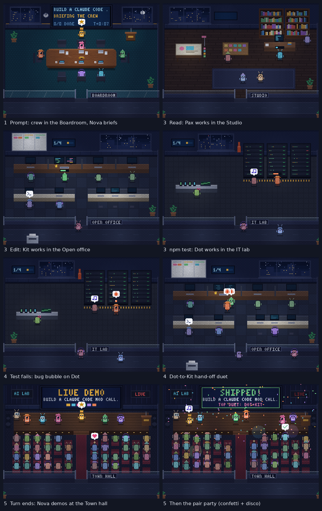

# Digital Workplace

A Claude Code mod that docks the pixel-art Digital Workplace office as a pane beside the chat. The crew acts out what Claude really does: prompts, plans, tool calls, failures and the end of each turn.

Created by **John Schettini** ([GitHub](https://github.com/johnschettini-ship-it)): the office art, the crew and the mod design.



## Install

At the prompt of a Claude Code terminal session (not in cmd or PowerShell):

```
/plugin install digital-workplace --marketplace johnschettini-ship-it/Board-Room
```

Answer `y` to add the marketplace, then pick a scope (user scope loads it in every session).

From a shell (cmd, PowerShell, bash) instead:

```
claude plugin install digital-workplace --marketplace johnschettini-ship-it/Board-Room
```

In the Claude desktop app, where `/plugin` does not run: click **+** next to the prompt box, then **Plugins**, **Add marketplace** with `johnschettini-ship-it/Board-Room`, then **Add plugin**.

## Use

- The pane opens when a session starts. Turn this off with the `openOnStart` setting.
- `/workplace` shows or hides the pane. `/workplace show`, `/workplace hide` and `/workplace status` also work.
- In the pane: room tabs (‹ ›), rooms in view (1, 2, 3), Auto camera, the crew strip (press a name to follow that agent) and Sound.
- In a cloud session the app gives mods no drawing surface. `/workplace` then says so in one line.

## The rooms

| Room | What happens there |
| --- | --- |
| Boardroom | Orchestration. Nova briefs the crew on each prompt, then stays at the wall screen, which shows the turn's KPIs: tokens in and out, tool calls (failed, running), plan progress, turn time and model requests. Each running subagent sits at the table in its model's colour, with a thought bubble while its request is open. |
| Open office | Execution. Pax, Kit, Vale, Iris and Dot work side by side at the top desk. Each monitor shows that crew member's tokens this turn. |
| Town hall | Shipping. When the turn ends, the crew demos the work and the pairs party. |
| Reception, Lead office, Studio, IT lab, Kitchen, Lounge | Supporting rooms with working cousins (NPCs). The crew takes breaks in the kitchen and lounge when idle; the IT lab racks light up with the compute. |

Tokens come from the usage Claude Code reports when each model request finishes; they are never estimated mid-stream. Each request's tokens are split evenly across the crew whose tools it asked for (a Read and an Edit: half to Pax, half to Kit). A request that asks for no work (an answer, a plan, a hand-off) counts for Nova. Totals are exact; the split per person is this attribution. Counts start again with each turn.

## What you see

The pane has three parts. The office is the show. The two text parts are the record.

- **Truth strip** (top of the pane): what runs now, as `● Kit (Build) · Edit · auth.ts · 0:04`. The raw tool and target stay next to the role, because a role is a guess for tools such as Bash. A call that needed your approval shows `? … · asked for your OK`. Claude Code reports when the dialog opens but not when you answer, so the mark records the ask and stays until the call ends. A failure stays as `✗ …` until the same target passes or the turn ends. More than four calls show as `+N more`. At the end of a turn the strip shows a receipt: `✓ Done in 1:12 · 4 reads, 2 edits, 1 test`.
- **KPI row** (under the strip's first line): `Tokens 18.5k in (92% cached) · 1.3k out · Calls 14 (1 failed) · Plan 2/5 · 9 req · 1:42`.
- **Compute rack** (under the room view): one machine per run. `main` is the main loop; each subagent gets its own row. A machine powers on at its first model request and shows model, effort, requests, tokens so far and time: `● main · opus 5.5 · high · 3 req · 52.1k in · 1.2k out · 0:41`. When the run ends it powers off and shows its tokens: `○ Explore · sonnet 5.5 · 18.2k in (12.0k cached) · 1.1k out · 0:22`. At most 8 rows, then `+N more`. The same machines light up as server racks in the IT lab, in the model's colour.
- **Status line**: Claude Code's own status bar shows the current call or `Nova thinking` while a turn runs.

## What drives the crew

| Event | In the office |
| --- | --- |
| You send a prompt | Reception logs it. The crew walks to the Boardroom and Nova briefs. The mission title is the first 60 characters of the prompt. |
| TodoWrite, TaskCreate, TaskUpdate, TaskList | Each item becomes a card on the Boardroom screen and the Open office kanban, as written. Cards are not assigned to a role: a guess from the text was often wrong. |
| Read, Grep, Glob, WebSearch, WebFetch | Pax (Research) works in the Open office. |
| Write or Edit on .css, .html, .tsx, .jsx, .svg | Iris (Design) works in the Open office. |
| Any other Write or Edit | Kit (Build) works in the Open office. |
| Bash with git diff, git log or a review command | Vale (Review) works in the Open office. |
| Bash with tests, builds or linters | Dot (QA) works in the Open office. A failing exit code shows a bug bubble and a Dot-to-Kit duet. |
| Other Bash | Pax for read-only commands (ls, cat, grep), else Kit. |
| Agent or Workflow launch | Nova hands off to the matching role in a duet. |
| Other tools | Nova (Lead) works at the boardroom screen. |
| A subagent's model request | The subagent sits at the boardroom table, thinking; its tokens join the KPIs. |
| The model thinks (no tool runs) | Nova stands at the board with a thought bubble. Nobody wanders off while a turn is open. |
| A permission dialog shows | The crew member shows a `?` bubble, and the strip marks the call `asked for your OK`. Not when a settings hook answers the request itself. |
| The turn ends | The crew goes straight to the Town hall, Nova demos, then the pairs party. |
| 60 seconds with nothing running | The crew goes idle: desks, coffee, lounge. The pane redraws at a quarter of the frame rate. |

Walks are short (the crew pops through the nearest door) so the office never lags behind the work.

In the Claude desktop app the office is full pixel art. In a terminal it is pixel art where the terminal shows pictures and coloured blocks elsewhere. A terminal cannot read the system's reduced-motion setting, so set `motion` to `reduced` there if you want it.

## Settings

| Setting | Default | Meaning |
| --- | --- | --- |
| `openOnStart` | true | Open the pane when a session starts. |
| `motion` | auto | `auto` hides confetti and disco when the system asks for reduced motion. `reduced` always calms the office. `full` always shows everything. |
| `theme` | auto | The world outside the windows: `night`, `sunset`, `day`, or `auto` from the host clock. |
| `frameRate` | 8 | Frames per second of the office animation, 2 to 10. In a terminal this is also how often the pane redraws. |
| `terminalArt` | auto | In a terminal: pictures in kitty, Ghostty and iTerm2, coloured quarter blocks elsewhere (Windows Terminal, VS Code, tmux). `blocks` or `image` forces one. |
| `toolChips` | false | Adds one line under each tool call in the transcript, such as `Kit · Edit auth.ts ✓ 0:03`. Local sessions only. Read at session start. |

## How it works

The hooks module has no DOM or canvas. `hooks/world.ts` is the page's own simulation and art, generated from `source/agent-boardroom.html` by `source/build_world.py`. It paints into a small software canvas (`hooks/raster.ts`).

- **Desktop, mobile and VS Code** get the office as a short film (`hooks/stage.ts`). The office runs ahead for up to 2 seconds, films each frame and rewinds. The Svg holds the first frame plus one layer per later frame with only the pixels that changed, all in one atlas PNG; CSS shows each layer at its time. The client plays it with no further messages, and the pane redraws only for a new film (at most once a second, sooner after a button press) or new text. A tape of the office's random draws makes the live office do exactly what the film showed until the next outside event. In a film the camera cuts to the next room instead of panning (a pan changes every pixel of every frame); the film ends at the cut and the next one starts there. Confetti and disco lights are a small CSS overlay that a `prefers-reduced-motion` media query hides; with reduced motion the film also holds still between redraws, unless `motion` is `full`.
- **Terminals** get a fresh picture or block-art frame at the frame rate, as before.

A busy two-second film is about 35 KB for one room and 85 to 100 KB for three, against 130 to 200 KB per second for a frame-by-frame stream. Filming costs 0.1 to 0.15 s of CPU per shot, at most one shot a second while the crew is busy; a hook that arrives mid-shot waits for it. When a terminal and an app view the same session at once, the terminal's full-rate redraws also re-send the film to the app. Hooks only observe: they never change or delay a tool call or a model request, and a fault in the mod is caught and ignored.

One ledger in the hooks module is the source of truth. `tool.call` records each call; `classic.PermissionRequest` marks a call as waiting; `turn.step` powers a machine on for each model request (the stream passes through untouched); `turn.complete` powers it off with the usage the engine reports. Subagent names come from one `$.agent.list()` per new agent, never polled. The design record is in [docs/design-panel](docs/design-panel/verdict.md).

To rebuild from a changed page:

```bash
python3 source/build_world.py source/agent-boardroom.html hooks/world.ts source/parts
```

Sound files come from `source/make_sounds.py` (the page's own chiptune). Sound plays only where Claude Code has an audio player (macOS).

## Tests

```bash
claude plugin test .
```

## License

MIT © 2026 John Schettini. See [LICENSE](LICENSE).
